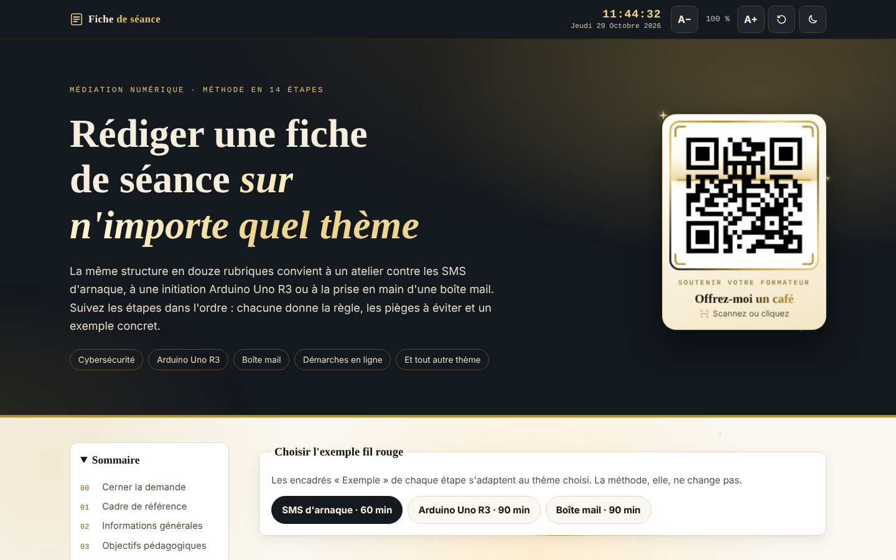
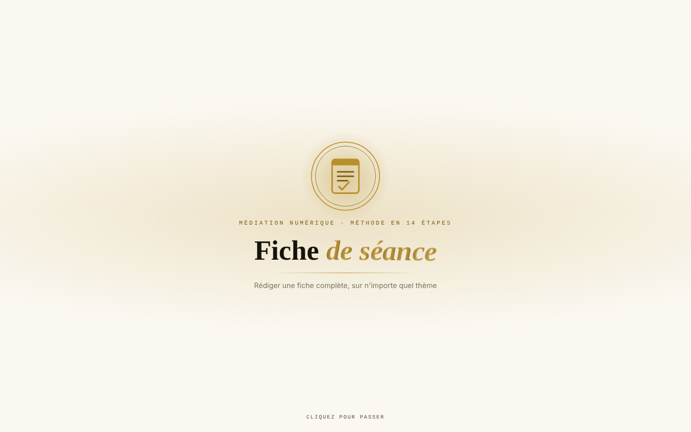
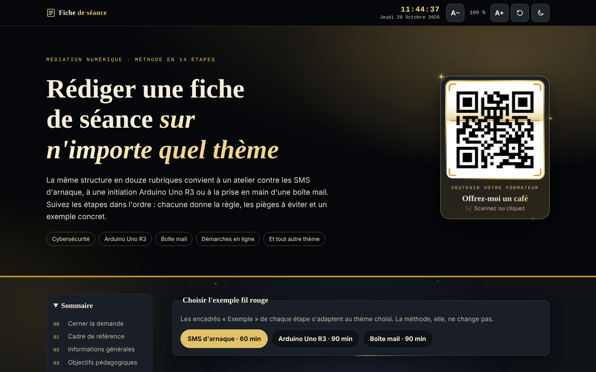
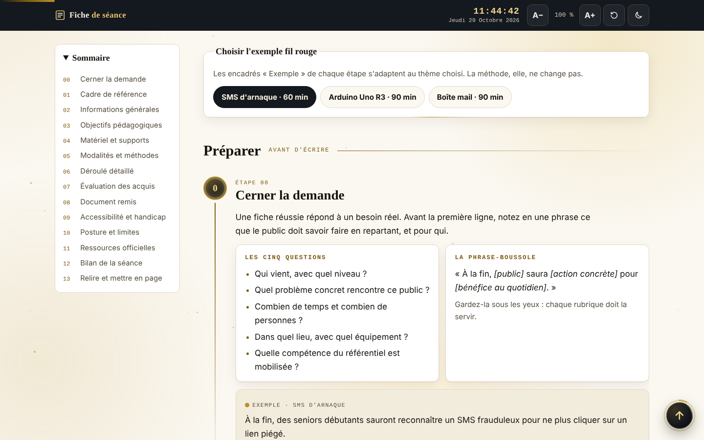
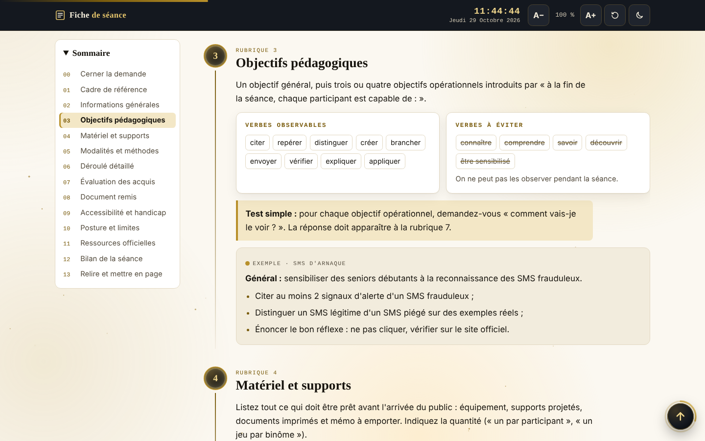
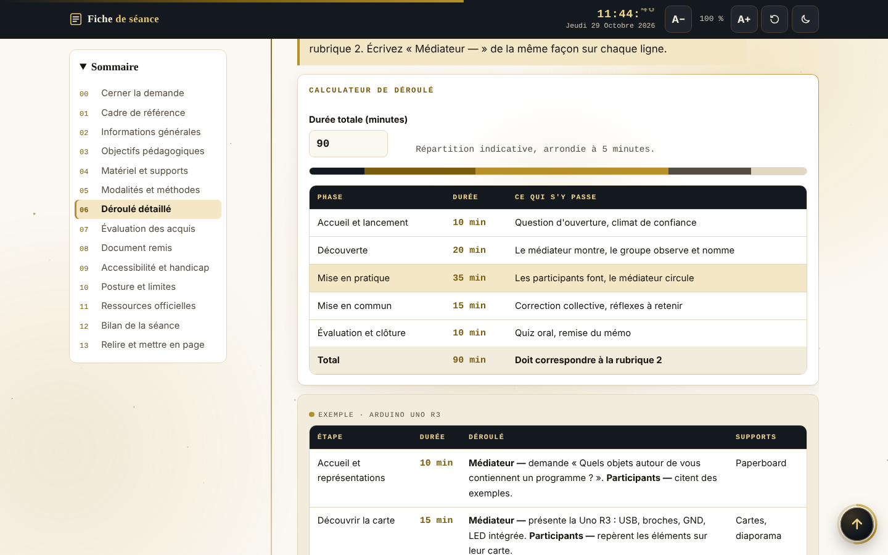
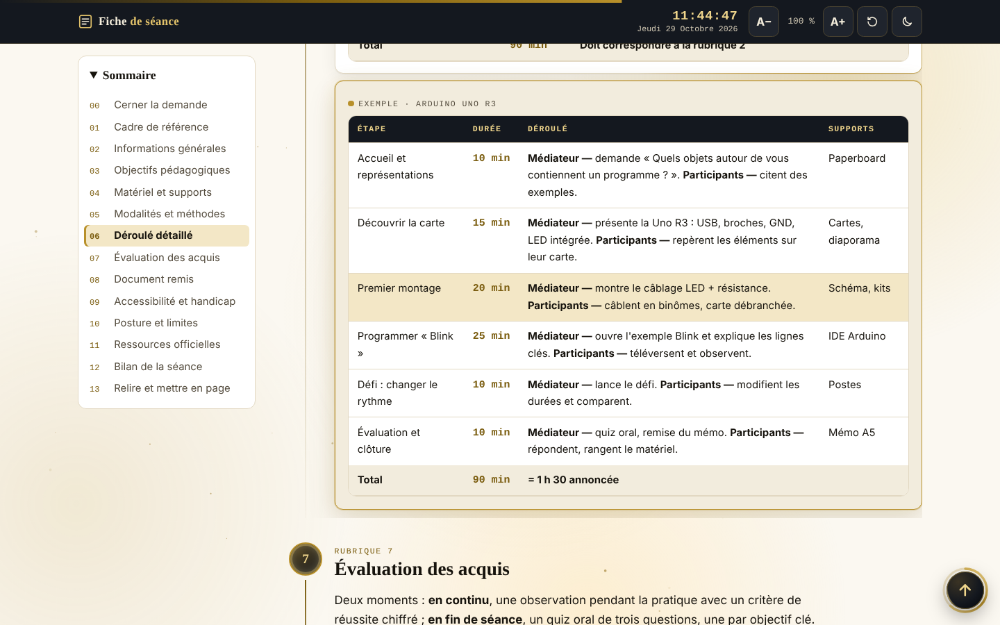
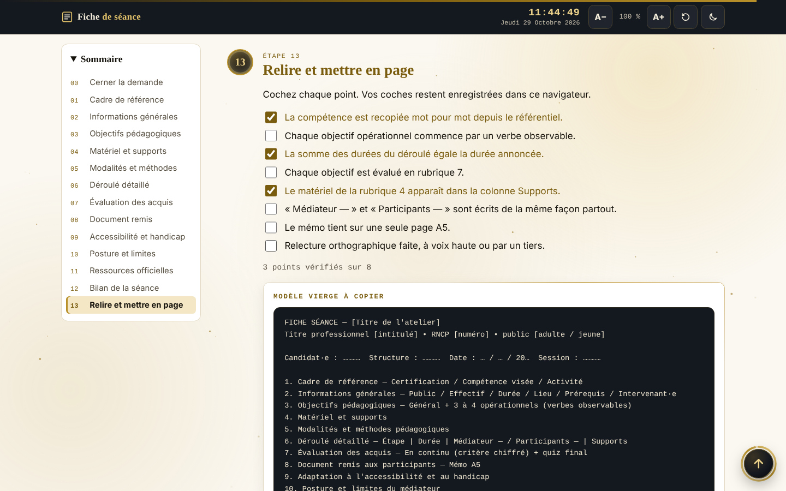
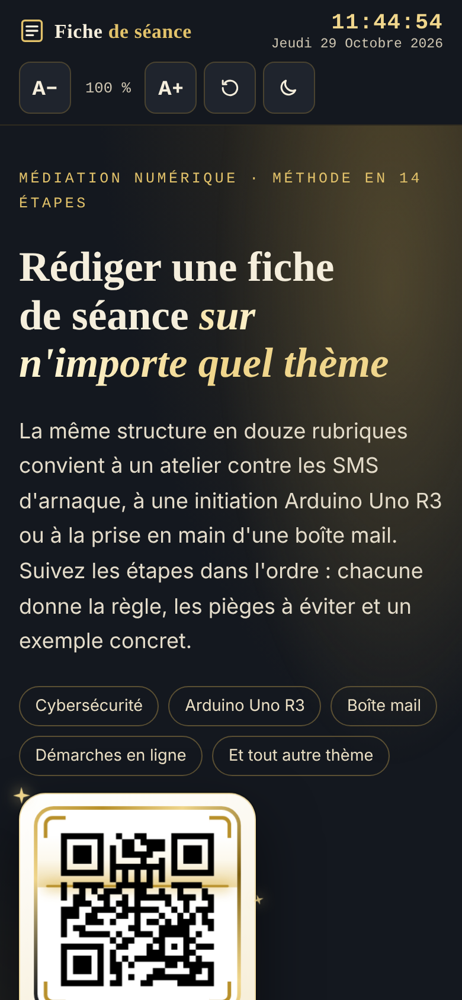
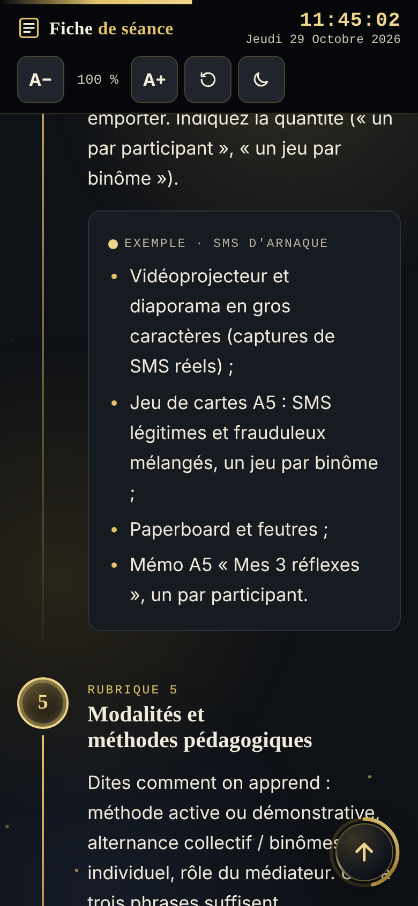

<div align="center">

# 📝 Guide de la fiche de séance

### Rédiger une fiche de séance complète, *sur n'importe quel thème*

**Médiation numérique · Méthode en 14 étapes · 12 rubriques**

[](https://pythonman83.github.io/fiche-de-seance/)
[](https://ko-fi.com/ondeaweb)


<br>



</div>

---

## 📚 Sommaire

- [Présentation](#-présentation)
- [Aperçu](#-aperçu)
- [Fonctionnalités](#-fonctionnalités)
- [Les 14 étapes de la méthode](#-les-14-étapes-de-la-méthode)
- [Les trois exemples fil rouge](#-les-trois-exemples-fil-rouge)
- [Structure du projet](#-structure-du-projet)
- [Mise en ligne sur GitHub Pages](#-mise-en-ligne-sur-github-pages)
- [Utilisation en local](#-utilisation-en-local)
- [Personnalisation](#-personnalisation)
- [Accessibilité](#-accessibilité)
- [Compatibilité](#-compatibilité)
- [Données enregistrées](#-données-enregistrées)
- [Auteur et soutien](#-auteur-et-soutien)

---

## 🎯 Présentation

Ce guide interactif accompagne pas à pas la rédaction d'une **fiche de séance** pour un atelier de médiation numérique. La même structure en **douze rubriques** convient aussi bien à un atelier contre les SMS d'arnaque qu'à une initiation **Arduino Uno R3** ou à la prise en main d'une **boîte mail**.

Chaque étape donne :

- ✅ **la règle** à appliquer ;
- ⚠️ **les pièges** à éviter ;
- 💡 **un exemple concret**, qui s'adapte au thème choisi.

Il s'adresse en priorité aux candidat·es du **Titre professionnel Médiateur Numérique (RNCP 40695)**, et plus largement à tout formateur ou animateur qui prépare un atelier.

> 💡 Toute la page tient dans **un seul fichier `index.html`** : aucun framework, aucune bibliothèque, aucun appel réseau. Elle fonctionne aussi hors ligne.

---

## 🖼️ Aperçu

### Ouverture animée

À l'ouverture, un rideau doré se lève sur le titre, lettre par lettre. Un clic ou une touche permet de passer l'animation.

<div align="center">

</div>

### Mode clair et mode sombre

Le thème suit celui du système, ou se change d'un clic dans le bandeau. Le changement se fait par une révélation circulaire depuis le bouton.

| Mode clair | Mode sombre |
|:---:|:---:|
|  |  |

### Choix de l'exemple fil rouge

Les encadrés « Exemple » de toutes les étapes changent selon le thème sélectionné.

<div align="center">

</div>

### Objectifs pédagogiques

Verbes observables à privilégier, verbes à éviter, et test de vérification.

<div align="center">

</div>

### Calculateur de déroulé

Saisissez la durée totale : le calculateur répartit le temps entre les cinq phases, arrondi à 5 minutes, avec une barre de proportions.

<div align="center">

</div>

### Déroulé détaillé (exemple Arduino Uno R3)

Tableau à quatre colonnes avec, à chaque ligne, ce que fait le médiateur et ce que font les participants.

<div align="center">

</div>

### Liste de relecture et modèle vierge

Huit points à cocher (mémorisés dans le navigateur) et un modèle de fiche à copier en un clic.

<div align="center">

</div>

### Sur téléphone

| Mobile · clair | Mobile · sombre |
|:---:|:---:|
|  |  |

---

## ✨ Fonctionnalités

### Contenu pédagogique

| Fonction | Description |
|---|---|
| 🧭 **14 étapes guidées** | De « Cerner la demande » à « Relire et mettre en page », en trois phases : *Préparer*, *Rédiger*, *Finaliser*. |
| 🔀 **3 exemples fil rouge** | SMS d'arnaque (60 min), Arduino Uno R3 (90 min), boîte mail (90 min). Le changement d'exemple fonctionne même sans JavaScript (CSS seul). |
| 🧮 **Calculateur de déroulé** | Répartition automatique d'une durée de 30 à 240 minutes sur cinq phases. |
| ☑️ **Liste de relecture** | Huit contrôles qualité cochables, avec compteur. |
| 📋 **Modèle vierge** | Trame de fiche copiable dans le presse-papiers. |

### Confort de lecture

| Fonction | Description |
|---|---|
| 🌗 **Thème clair / sombre** | Automatique selon le système, ou manuel. Choix mémorisé. |
| 🔠 **Taille du texte** | Boutons A− / A+ (de 87,5 % à 175 %) et retour à 100 %. Choix mémorisé. |
| 🕒 **Horloge en temps réel** | Heure et date au format français dans le bandeau. |
| 📑 **Sommaire collant** | Met en évidence l'étape en cours ; replié automatiquement sur petit écran. |
| 📊 **Barre de progression** | Indique la position dans la page. |
| ⬆️ **Retour en haut** | Bouton avec anneau de progression, étincelles et petit signal sonore à l'arrivée. |

### Effets visuels « Obsidienne & Or »

- Rideau d'ouverture avec titre lettre par lettre ;
- Aurore dorée et poussière d'or flottante en arrière-plan ;
- Projecteur lumineux qui suit la souris sur les cartes ;
- Apparition progressive des étapes au défilement ;
- Bordures de lumière tournantes sur les cadres principaux ;
- Carte QR code Ko-fi en 3D avec laser de scan, reflet et étincelles.

> Tous ces effets sont **désactivés automatiquement** si l'utilisateur a demandé à son système de réduire les animations.

---

## 🗺️ Les 14 étapes de la méthode

| Phase | N° | Étape | Ce qu'on y trouve |
|---|:---:|---|---|
| **Préparer** | 00 | Cerner la demande | Les cinq questions et la phrase-boussole |
| **Rédiger** | 01 | Cadre de référence | Certification, compétence visée, activité |
| | 02 | Informations générales | Public, effectif, durée, lieu, prérequis, intervenant·e |
| | 03 | Objectifs pédagogiques | Objectif général + 3 à 4 opérationnels |
| | 04 | Matériel et supports | Liste avec quantités |
| | 05 | Modalités et méthodes | Méthode active, alternance des temps |
| | 06 | Déroulé détaillé | Tableau + calculateur |
| | 07 | Évaluation des acquis | En continu et en fin de séance |
| | 08 | Document remis | Mémo A5 en gros caractères |
| | 09 | Accessibilité et handicap | Quatre adaptations concrètes |
| | 10 | Posture et limites | Ce que le médiateur ne fait jamais |
| | 11 | Ressources officielles | Sources publiques et documentations |
| | 12 | Bilan de la séance | Points forts, difficultés, ajustements |
| **Finaliser** | 13 | Relire et mettre en page | Liste de relecture + modèle vierge |

---

## 🔀 Les trois exemples fil rouge

| | 📱 SMS d'arnaque | 🔌 Arduino Uno R3 | ✉️ Boîte mail |
|---|---|---|---|
| **Public** | Seniors grands débutants | Ados et adultes curieux | Adultes débutants |
| **Durée** | 60 min | 90 min | 90 min |
| **Effectif** | 6 à 8 | 6 à 8 (un kit pour deux) | 5 à 8 (un poste chacun) |
| **Objectif** | Reconnaître un SMS frauduleux | Programmer une LED avec « Blink » | Envoyer un courriel avec pièce jointe |
| **Ressources** | cybermalveillance.gouv.fr, 33700 | docs.arduino.cc | cybermalveillance.gouv.fr, cnil.fr |

---

## 📁 Structure du projet

```text
fiche-de-seance/
├── index.html              ← la page complète (HTML, CSS et JavaScript intégrés)
├── qrcode.png              ← QR code Ko-fi affiché dans l'en-tête (820 × 820 px)
├── README.md               ← ce fichier
└── docs/
    └── images/             ← captures d'écran utilisées dans le README
        ├── 01-intro.png
        ├── 02-accueil-clair.png
        ├── 03-accueil-sombre.png
        ├── 04-selecteur-exemples.png
        ├── 05-objectifs.png
        ├── 06-calculateur.png
        ├── 07-deroule-arduino.png
        ├── 08-relecture-modele.png
        ├── 09-mobile-clair.png
        └── 10-mobile-sombre.png
```

> ⚠️ **Important :** le fichier `qrcode.png` doit se trouver **à côté de `index.html`**, sinon la carte Ko-fi de l'en-tête affichera une image cassée.

---

## 🚀 Mise en ligne sur GitHub Pages

### 1. Créer le dépôt

1. Connectez-vous sur [github.com](https://github.com).
2. Cliquez sur **New repository**.
3. Nommez-le par exemple `fiche-de-seance`, laissez-le en **Public**, puis cliquez sur **Create repository**.

### 2. Envoyer les fichiers

**Option A — depuis le navigateur (le plus simple)**

1. Dans le dépôt vide, cliquez sur **uploading an existing file**.
2. Glissez-déposez `index.html`, `qrcode.png`, `README.md` et le dossier `docs`.
3. Cliquez sur **Commit changes**.

**Option B — en ligne de commande**

```bash
cd fiche-de-seance
git init
git add .
git commit -m "Guide de la fiche de séance"
git branch -M main
git remote add origin https://github.com/pythonman83/fiche-de-seance.git
git push -u origin main
```

### 3. Activer GitHub Pages

1. Dans le dépôt, ouvrez **Settings** → **Pages**.
2. Sous **Build and deployment**, choisissez **Source : Deploy from a branch**.
3. Sélectionnez la branche **`main`** et le dossier **`/ (root)`**, puis **Save**.
4. Patientez une à deux minutes, puis rechargez la page des réglages.

Le guide est en ligne à l'adresse :

```text
https://pythonman83.github.io/fiche-de-seance/
```

> 💡 Si vous choisissez un autre nom de dépôt, remplacez `fiche-de-seance` dans l'adresse et dans le badge « Voir en ligne » en haut de ce README.

### 4. Vérifier

- [ ] L'animation d'ouverture s'affiche puis disparaît ;
- [ ] Le QR code Ko-fi apparaît dans l'en-tête ;
- [ ] Le changement d'exemple modifie les encadrés ;
- [ ] Le bouton « Copier le modèle » fonctionne (il nécessite HTTPS, fourni par GitHub Pages).

---

## 💻 Utilisation en local

Double-cliquez simplement sur `index.html` : la page s'ouvre dans le navigateur.

Pour profiter de toutes les fonctions (copie dans le presse-papiers notamment), lancez plutôt un petit serveur local :

```bash
# Avec Python
python -m http.server 8000

# Ou avec Node.js
npx serve .
```

Puis ouvrez `http://localhost:8000`.

---

## 🎨 Personnalisation

### Couleurs

Toutes les couleurs sont des variables CSS déclarées sur `:root`, en haut du fichier :

```css
:root{
  --bg:#FBF8F1;       /* fond papier ivoire */
  --ink:#16130D;      /* texte */
  --gold:#7A5C0E;     /* or (texte et liens) */
  --gold-hi:#B8902A;  /* or vif (accents) */
  --obsidian:#14181F; /* bandeau et en-tête */
}
```

Le mode sombre redéfinit les mêmes variables dans `@media (prefers-color-scheme:dark)` et `:root[data-theme="dark"]`.

### Ajouter un quatrième exemple fil rouge

1. Ajoutez un bouton radio dans le bloc `.seg` :
   ```html
   <input type="radio" name="ex" id="ex-admin" value="admin">
   <label for="ex-admin">Démarches en ligne · 90 min</label>
   ```
2. Ajoutez la règle CSS correspondante :
   ```css
   .show-admin .ex--admin{display:block}
   ```
3. Dans chaque étape, ajoutez un encadré :
   ```html
   <div class="example ex ex--admin">
     <span class="label">Exemple · Démarches en ligne</span>
     <p>…</p>
   </div>
   ```

### Remplacer le QR code

Remplacez `qrcode.png` par votre propre image carrée (820 × 820 px conseillé) et modifiez le lien `https://ko-fi.com/ondeaweb` dans la balise `<a class="qr">`.

### Désactiver l'animation d'ouverture

Supprimez le bloc compris entre `<!-- ===== AJOUT : intro « waouh »` et `<!-- ===== FIN AJOUT intro ===== -->`, en conservant le petit script qui applique le thème et la taille mémorisés.

---

## ♿ Accessibilité

- Lien d'évitement **« Aller au contenu »** ;
- Navigation complète au **clavier**, avec contour de focus doré bien visible ;
- Zones cliquables d'au moins **44 × 44 px** ;
- Textes alternatifs, rôles et libellés ARIA (`aria-label`, `aria-live`, `aria-labelledby`) ;
- Contrastes renforcés dans les deux thèmes ;
- Taille du texte réglable jusqu'à **175 %** ;
- Respect de **« réduire les animations »** (`prefers-reduced-motion`) ;
- Prise en compte des encoches d'écran (`safe-area-inset`) sur mobile ;
- Exemples consultables **sans JavaScript**.

---

## 🌐 Compatibilité

| Navigateur | Prise en charge |
|---|---|
| Chrome / Edge (récents) | ✅ Complète, y compris la transition de thème circulaire |
| Firefox (récent) | ✅ Complète (transition de thème simple) |
| Safari macOS / iOS (récents) | ✅ Complète |
| Navigateurs anciens | ⚠️ Contenu lisible, effets avancés ignorés |

---

## 💾 Données enregistrées

La page n'envoie **aucune donnée** et ne contient **aucun traceur**. Seules quelques préférences sont gardées dans le `localStorage` du navigateur de chaque visiteur :

| Clé | Contenu |
|---|---|
| `fs-theme` | Thème choisi (`light` ou `dark`) |
| `fs-scale` | Taille du texte |
| `fs-c1` à `fs-c8` | État des cases de la liste de relecture |

Pour tout effacer : vider les données du site dans les réglages du navigateur.

---

## 👤 Auteur et soutien

**Jean-Claude Lugo** — Formateur expert, Centre de Formation MODE 83 (Draguignan, Var)
**Ondea Web Studio**

- 🐙 GitHub : [@pythonman83](https://github.com/pythonman83)
- ☕ Ko-fi : [ko-fi.com/ondeaweb](https://ko-fi.com/ondeaweb)
- 🛒 Gumroad : [ljcwhisper8.gumroad.com](https://ljcwhisper8.gumroad.com)
- 🛍️ Payhip : [payhip.com/OndeaWeb](https://payhip.com/OndeaWeb)

Si ce guide vous a aidé à préparer votre fiche de séance, vous pouvez **offrir un café** via Ko-fi ☕ ou laisser une ⭐ sur le dépôt.

---

<div align="center">

*Guide de la fiche de séance · Médiation numérique · Méthode valable pour tout thème d'atelier*

</div>
